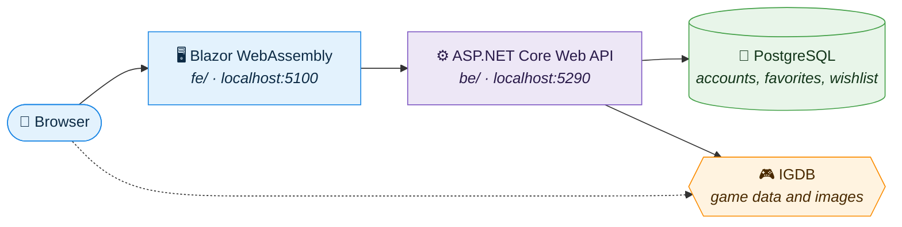

# Terranova Game Explorer

Web app to explore video games: search and game pages, plus accounts with favorites, wishlist and a profile. Game data comes from IGDB.

## How the project is divided

Two separate apps and one database:



The client calls the API over HTTP with the login cookie; the API reads and writes the database with EF Core and asks IGDB for game data (with a token from Twitch). The dotted line: the browser loads covers and screenshots directly from IGDB's image server.

| Folder | What it contains |
|---|---|
| `be/` | Web API: endpoints, IGDB service, cache, Entity Framework, login, [be/README.md](be/README.md) |
| `fe/` | Blazor WebAssembly client: pages, components, HTTP client towards the API, [fe/README.md](fe/README.md) |
| `shared/GameExplorer.Shared` | Models exchanged between API and client (the contract between the two apps) |
| `db/` | database setup: init scripts, migration and backup scripts, [db/README.md](db/README.md) |
| `DOCS/` | plans, decisions ([ADR](DOCS/adr/)) and team rules |

Rules that follow from this split:

- Only the Web API talks to the database and to the external APIs. The client talks only to the API.
- The client runs in the browser and anyone can read it: no keys or passwords in it.
- Passwords and keys live in `secrets/` (git-ignored), never in the repository.

## Run it

```bash
make start
```

Before the first start you need the five files in `secrets/`. Requirements, commands without `make`, tests and every database command: [db/README.md](db/README.md).

## Team

Three developers, one area each. Everyone owns the folders of their area: work in someone else's area goes through a small PR reviewed by its owner.

| | [@K0ff33Blu3](https://github.com/K0ff33Blu3) | [@fmartini02](https://github.com/fmartini02) | [@Elmond0](https://github.com/Elmond0) |
|---|---|---|---|
| **Area** | Web API and game data | Client and interface | Database and accounts |
| **Folders** | `be/` (Controllers, Services, Errors) | `fe/` | `db/`, `be/` (Auth, Data), `compose.yaml`, `Makefile` |

### [@K0ff33Blu3](https://github.com/K0ff33Blu3) – Web API and game data

- Solution with the three projects, CORS, the shared models
- IGDB service: search with filters and sorting, game details, home lists, studios, platform highlights (first on RAWG, then moved to IGDB: [ADR-07](DOCS/adr/adr-07-da-rawg-a-igdb.md))
- Endpoints `api/games`, `api/genres`, `api/platforms`, `api/studios`
- Twitch token, in-memory cache, retries and timeouts towards IGDB
- IGDB errors turned into a single `502` with `ProblemDetails`
- Postman collection of the games

### [@fmartini02](https://github.com/fmartini02) – Client and interface

- MudBlazor theme, layout and game card; light/dark theme remembered between visits
- Pages: home, search with filters read from the address, game page, studio page, profile
- HTTP client towards the API, with a fake version to work before the API was ready
- Login and registration pages, login state in the client, favorites and wishlist buttons
- Loading, error and no-result states
- Client tests with bUnit and the workflow that runs them on every PR

### [@Elmond0](https://github.com/Elmond0) – Database and accounts

- PostgreSQL in Docker Compose with three separate database users, `make` commands, `secrets/` folder
- EF Core with Npgsql, the tables and all the migrations ([ADR-05](DOCS/adr/adr-05-database.md))
- Login with cookie, password hashing and session stamp, instead of ASP.NET Core Identity ([ADR-04](DOCS/adr/adr-04-login-cookie.md))
- Protected endpoints `api/me`: favorites, wishlist, profile, account delete ([ADR-06](DOCS/adr/adr-06-account-preferiti.md))
- Database CI workflow and the Postman collection of the account

### Together

- Stack and API contract ([ADR-01](DOCS/adr/adr-01-stack.md), [ADR-02](DOCS/adr/adr-02-contratto-api.md), [ADR-03](DOCS/adr/adr-03-organizzazione-codice.md)) and MudBlazor as the UI library
- Changes to the shared models agreed between who uses them
- Every PR reviewed by another member, never pushed straight to `main`

Branch, commit and pull request rules: [DOCS/git-workflow.md](DOCS/git-workflow.md). Phases and what is still open: [DOCS/Suddivisione del lavoro.md](DOCS/Suddivisione%20del%20lavoro.md).
