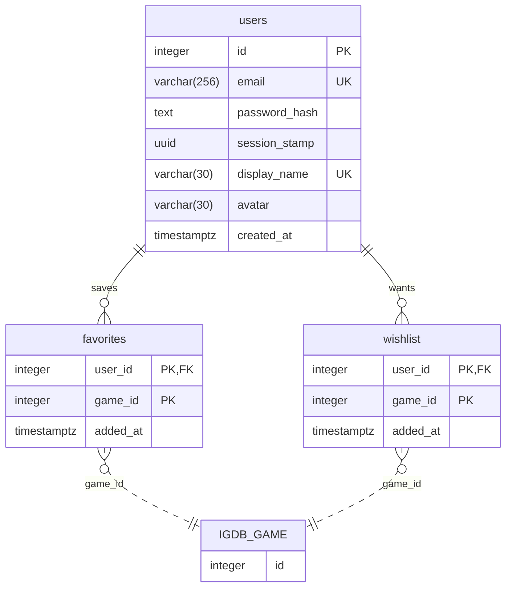

# Local database

PostgreSQL 18 in Docker Compose, for **local development only** (not production).

Run all commands from the repository root.

There are two ways to bring the site up. Both start from [Requirements](#1-requirements) and [Secret files](#2-secret-files), then pick one:

- **[Path A: with make](#path-a-with-make)**: one command does everything. Linux, macOS, and Windows in Git Bash.
- **[Path B: without make](#path-b-without-make)**: the same steps by hand, with the commands for each OS.

When it is up, the site is at http://localhost:5100 and the API at http://localhost:5290.

## Contents

- [1. Requirements](#1-requirements)
- [2. Secret files](#2-secret-files)
- [Path A: with make](#path-a-with-make)
- [Path B: without make](#path-b-without-make)
  - [B1. Create .env](#b1-create-env)
  - [B2. Start the database](#b2-start-the-database)
  - [B3. Set the backend variables](#b3-set-the-backend-variables)
  - [B4. Apply the migrations](#b4-apply-the-migrations)
  - [B5. Start the API and the client](#b5-start-the-api-and-the-client)
- [Connect with psql](#connect-with-psql)
- [Adminer (web UI)](#adminer-web-ui)
- [Schema](#schema)
- [Database users](#database-users)
- [Backup and restore](#backup-and-restore)
- [Stop vs reset](#stop-vs-reset)
- [Create a migration (only Elmond0)](#create-a-migration-only-elmond0)
- [Troubleshooting](#troubleshooting)

## 1. Requirements

All OSes:

- Docker Engine **25+** and Docker Compose **2.20.2+** (check with `docker version` and `docker compose version`). On macOS and Windows install [Docker Desktop](https://docs.docker.com/desktop/), which includes both
- .NET **10** SDK, for the migrations (check with `dotnet --version`)
- A Twitch account with 2FA enabled, to get the IGDB keys (see [Secret files](#2-secret-files))

Only for [Path A](#path-a-with-make), `make`:

- Linux: install it with your package manager (`make` or `build-essential`)
- macOS: it comes with `xcode-select --install`
- Windows: `winget install ezwinports.make`, then open a new terminal

Windows only:

- **Git Bash** (comes with [Git for Windows](https://git-scm.com/download/win)): `make` and the `.sh` scripts need `bash`
- **PowerShell 7**, not Windows PowerShell 5.1, for the PowerShell commands in this file (`winget install Microsoft.PowerShell`)

## 2. Secret files

Passwords and keys live in the `secrets/` folder at the repository root, one line per file, **never committed** (it is in `.gitignore`).
You create the files once; `make` stops and names the missing one if you forget.

| File | Content | Used by |
|---|---|---|
| `secrets/postgres_password.txt` | password of `terranova` (admin) | the `db` container |
| `secrets/app_db_password.txt` | password of `terranova_app` (migrations) | the `db` container |
| `secrets/api_db_password.txt` | password of `terranova_api` (backend) | the `db` container and the backend connection string |
| `secrets/twitch_id.txt` | Twitch **Client ID** | the backend (`Igdb__ClientId`) |
| `secrets/twitch_key.txt` | Twitch **Client Secret** | the backend (`Igdb__ClientSecret`) |

The Twitch keys are for IGDB: create an app in the [Twitch developer console](https://dev.twitch.tv/console) (the Client Secret is shown only once, copy it right away). The step-by-step guide is in `DOCS/qa-and-igdb-guide.md`.

Create the files (the three passwords are random; the Twitch values are typed without echo).

**bash** (Linux, Windows in Git Bash):

```bash
mkdir -p secrets
for f in postgres_password app_db_password api_db_password; do
  openssl rand -hex 24 | tr -d '\n' > secrets/$f.txt
done
read -rsp "Twitch Client ID: " v && printf %s "$v" > secrets/twitch_id.txt; unset v
read -rsp "Twitch Client Secret: " v && printf %s "$v" > secrets/twitch_key.txt; unset v
chmod 644 secrets/*.txt   # Linux: the postgres user in the container must be able to read them
```

**zsh** (macOS default, or Linux with zsh):

```zsh
mkdir -p secrets
for f in postgres_password app_db_password api_db_password; do
  openssl rand -hex 24 | tr -d '\n' > secrets/$f.txt
done
read -rs "v?Twitch Client ID: " && printf %s "$v" > secrets/twitch_id.txt; unset v; echo
read -rs "v?Twitch Client Secret: " && printf %s "$v" > secrets/twitch_key.txt; unset v; echo
chmod 644 secrets/*.txt
```

**fish** (Linux or macOS):

```fish
mkdir -p secrets
for f in postgres_password app_db_password api_db_password
    openssl rand -hex 24 | tr -d '\n' > secrets/$f.txt
end
read -s -P "Twitch Client ID: " v && printf %s "$v" > secrets/twitch_id.txt; set -e v
read -s -P "Twitch Client Secret: " v && printf %s "$v" > secrets/twitch_key.txt; set -e v
chmod 644 secrets/*.txt
```

**Windows (PowerShell 7)**:

```powershell
New-Item -ItemType Directory -Force secrets | Out-Null
foreach ($f in 'postgres_password', 'app_db_password', 'api_db_password') {
    Set-Content -NoNewline "secrets/$f.txt" ([Convert]::ToHexString([Security.Cryptography.RandomNumberGenerator]::GetBytes(24)).ToLower())
}
Set-Content -NoNewline secrets/twitch_id.txt (Read-Host 'Twitch Client ID' -MaskInput)
Set-Content -NoNewline secrets/twitch_key.txt (Read-Host 'Twitch Client Secret' -MaskInput)
```

Rules for these files:

- Passwords: only letters and digits (`;` and `=` break the connection string). The commands above already do.
- Twitch files: exactly **30 bytes** each, the bare value with no newline or hidden characters, otherwise Twitch answers `400 Bad Request`. Check it:

  ```bash
  wc -c secrets/twitch_id.txt secrets/twitch_key.txt   # bash, zsh, fish, Git Bash: must print 30 and 30
  ```

  ```powershell
  Get-Item secrets/twitch_*.txt | Select-Object Name, Length   # PowerShell: Length must be 30 and 30
  ```

- Passwords are read only on the first start: to change one, [reset the database](#stop-vs-reset).

## Path A: with make

Same commands on Linux and macOS. On **Windows**, run them in **Git Bash**, not PowerShell: the Makefile needs `bash`.

1. Database and migrations:

   ```bash
   make
   ```

   It creates `.env` from `.env.example` if missing, checks the [secret files](#2-secret-files), starts the database and applies the migrations. Running it again is safe.

2. API and client:

   ```bash
   make dev
   ```

   Open http://localhost:5100. `Ctrl+C` stops API and client; the database keeps running.

`make start` does 1 and 2 in one command.

After a `git pull` that brings new migrations: `make migrate`.

`make dev` and `make migrate` pass the [backend variables](#b3-set-the-backend-variables) by themselves, read from `secrets/`: nothing to set by hand.

All the targets:

| Command | What it does |
|---|---|
| `make start` | everything: `make`, then `make dev` |
| `make` | `.env`, secret check, database, migrations |
| `make up` | only `.env`, secret check and database |
| `make secrets` | only checks that the five secret files exist and are not empty |
| `make migrate` | applies the missing migrations (passes the backend variables) |
| `make dev` | Web API and client together, with the backend variables (`Ctrl+C` stops both) |
| `make test` | all the tests (Docker must be running: they start their own temporary database) |
| `make adminer` | database and [Adminer](#adminer-web-ui) |
| `make adminer-stop` | stops and removes only Adminer, the database keeps running |
| `make ps` | status of the containers |
| `make logs` | follows the logs (`Ctrl+C` to leave) |
| `make clean` | stops the containers, **keeps** the data |
| `make fclean` | **deletes the local data** (asks for `yes`); the `secrets/` files stay |
| `make re` | `fclean`, then `make` |

## Path B: without make

The same steps `make` does, one at a time. Do them in order, **in the same terminal** from B3 on: the variables live only in that terminal.

Each step has a block for every terminal: **bash** (Linux, Git Bash on Windows), **zsh** (macOS default), **fish**, **PowerShell 7** (Windows). When the commands are the same, one block lists all the terminals it works in.

### B1. Create .env

**bash, zsh, fish, Git Bash**:

```bash
cp .env.example .env
```

**PowerShell 7**:

```powershell
Copy-Item .env.example .env
```

`.env` holds only non-secret settings (names and ports), so it is safe to leave as it is. The database listens only on `127.0.0.1:5432` (change `POSTGRES_PORT` in `.env` if 5432 is already in use, and use the same port in the connection string of B3).

### B2. Start the database

**All terminals** (bash, zsh, fish, Git Bash, PowerShell 7):

```bash
docker compose up -d --wait   # returns when the database is healthy
docker compose ps             # db should be "healthy"
```

On the first start the `db/init/` scripts create the two [database users](#database-users) of the app.

> Passwords and `db/init/` scripts apply **only on the first start** of the volume.
> If you change them later, reset the database (see [Stop vs reset](#stop-vs-reset)).

### B3. Set the backend variables

The backend needs three values that are never stored in the repository: the connection string and the two IGDB keys. They are read from `secrets/` and passed as environment variables, so no password is typed or kept in the shell history. There are no .NET User Secrets: everything lives in `secrets/`.

| Variable | Value |
|---|---|
| `ConnectionStrings__Default` | host, port, database and user from `.env`, password from `secrets/api_db_password.txt` |
| `Igdb__ClientId` | `secrets/twitch_id.txt` |
| `Igdb__ClientSecret` | `secrets/twitch_key.txt` |

(`__` stands for `:` in configuration names: `ConnectionStrings__Default` is `ConnectionStrings:Default`.)

**bash, zsh, Git Bash**:

```bash
export ConnectionStrings__Default="Host=localhost;Port=5432;Database=terranova;Username=terranova_api;Password=$(< secrets/api_db_password.txt)"
export Igdb__ClientId="$(< secrets/twitch_id.txt)"
export Igdb__ClientSecret="$(< secrets/twitch_key.txt)"
```

**fish**:

```fish
set -x ConnectionStrings__Default "Host=localhost;Port=5432;Database=terranova;Username=terranova_api;Password="(cat secrets/api_db_password.txt)
set -x Igdb__ClientId (cat secrets/twitch_id.txt)
set -x Igdb__ClientSecret (cat secrets/twitch_key.txt)
```

**PowerShell 7**:

```powershell
$pw = (Get-Content -Raw secrets/api_db_password.txt).Trim()
$env:ConnectionStrings__Default = "Host=localhost;Port=5432;Database=terranova;Username=terranova_api;Password=$pw"
$env:Igdb__ClientId = (Get-Content -Raw secrets/twitch_id.txt).Trim()
$env:Igdb__ClientSecret = (Get-Content -Raw secrets/twitch_key.txt).Trim()
Remove-Variable pw
```

The variables last only for that terminal window. In an IDE, set the same three variables in the run configuration of the API project (do not commit them).

- From a container the host is `db` instead of `localhost`.
- Online the same variables are used, set by the hosting service.

Never use `terranova_app` here: its password is needed only by `migrate.sh` and restore.

### B4. Apply the migrations

The tables are created only by EF Core migrations (`be/GameExplorer.Api/Data/Migrations/`), applied by `db/scripts/migrate.sh` as `terranova_app`. `dotnet ef` needs the variables of B3, so stay in the same terminal.

**bash, zsh, fish, Git Bash**:

```bash
dotnet tool restore                  # once per clone: installs dotnet-ef from dotnet-tools.json
dotnet restore be/GameExplorer.Api   # once per clone: downloads the NuGet packages dotnet-ef needs
./db/scripts/migrate.sh              # applies the missing migrations
```

**PowerShell 7**: the script runs with the `bash` of Git for Windows, which sees the variables set in B3:

```powershell
dotnet tool restore
dotnet restore be/GameExplorer.Api
& "$env:ProgramFiles\Git\bin\bash.exe" db/scripts/migrate.sh
```

Run it again after a `git pull` that brings new migrations: running it twice is safe, applied migrations are skipped.

Check that the tables exist (all terminals):

```bash
docker compose exec -T db psql -U terranova -d terranova -c '\dt'
```

### B5. Start the API and the client

API, in the same terminal as B3 (all terminals):

```bash
dotnet run --launch-profile http --project be/GameExplorer.Api
```

Client, in a second terminal (all terminals; no variables needed, the client does not talk to the database):

```bash
dotnet run --launch-profile http --project fe/GameExplorer.Client
```

Open http://localhost:5100. `Ctrl+C` in each terminal stops them; the database keeps running.

Other Docker commands (all terminals):

```bash
docker compose ps               # status
docker compose logs -f db       # logs (queries slower than 200 ms are logged here)
docker compose stop             # stop, keep the containers
docker compose start            # start again
```

## Connect with psql

All OSes:

```bash
docker compose exec db psql -U terranova -d terranova
```

Useful commands inside psql: `\dt` tables · `\d <table>` structure · `\dx` extensions · `\du` users · `\q` quit.

## Adminer (web UI)

| | Start | Stop |
|---|---|---|
| with make | `make adminer` | `make adminer-stop` |
| without make (all OSes) | `docker compose --profile tools up -d --wait` | `docker compose --profile tools rm -sf adminer` |

Open http://localhost:8080 (port: `ADMINER_PORT` in `.env`) and log in with:

| Field    | Value                                                                                          |
|----------|------------------------------------------------------------------------------------------------|
| System   | **PostgreSQL** (the default is MySQL)                                                          |
| Server   | `db`                                                                                           |
| Username | `terranova`, `terranova_app` or `terranova_api`                                                |
| Password | the content of `secrets/postgres_password.txt`, `secrets/app_db_password.txt` or `secrets/api_db_password.txt` |
| Database | `terranova`                                                                                    |

Stopping Adminer leaves the database running.

## Schema

The tables that the EF Core migrations create. The source of truth is `be/GameExplorer.Api/Data/` (entities and `Configurations/`): update this diagram when a migration changes the tables.



| Rule | Where |
|---|---|
| `email` and `display_name` are unique and case-insensitive | `users` |
| `display_name` and `avatar` can be empty, the other columns cannot | `users` |
| Only the password hash is stored | `users.password_hash` |
| The same game cannot be saved twice by the same user (key on `user_id` + `game_id`) | `favorites`, `wishlist` |
| Deleting a user also deletes their favorites and wishlist | `favorites`, `wishlist` |
| `game_id` has no FK: the dotted line means the game lives on IGDB, not in this database | `favorites`, `wishlist` |

## Database users

| User | Used by | Can do |
|---|---|---|
| `terranova` | `backup.sh`, and maintenance by hand (psql, Adminer) | everything (superuser) |
| `terranova_app` | `migrate.sh` and restore | create, alter and drop tables (owner of the database) |
| `terranova_api` | the backend, at runtime | `SELECT`, `INSERT`, `UPDATE`, `DELETE` on rows, only `SELECT` on `__EFMigrationsHistory`; **not** `CREATE`, `ALTER`, `DROP`, `TRUNCATE` |

`db/init/01-app-user.sh` creates `terranova_app`, `db/init/02-api-user.sh` creates `terranova_api`. Both read the password from the secret files that Docker mounts in the container (`/run/secrets/`).
Tables that `terranova_app` creates later (EF Core migrations) are readable and writable by `terranova_api` automatically (`ALTER DEFAULT PRIVILEGES`).

The backend always connects as `terranova_api`: if it has a bug, it cannot change or drop tables.

## Backup and restore

Backup (the database must be running). Creates `db/backups/terranova_<date>_<time>.sql`.

Linux, macOS, Windows in Git Bash:

```bash
./db/scripts/backup.sh
```

Windows (PowerShell 7):

```powershell
& "$env:ProgramFiles\Git\bin\bash.exe" db/scripts/backup.sh
```

`db/backups/` is ignored by git: backups contain real data, never commit them.

Restore (as the migrations user `terranova_app`, so restored tables belong to it and stay readable by `terranova_api`). Linux, macOS, and Windows in **Git Bash** (the `<` redirect does not work in PowerShell):

```bash
docker compose exec -T db sh -c 'psql -v ON_ERROR_STOP=1 -U "$APP_DB_USER" -d "$POSTGRES_DB"' < db/backups/terranova_20261025_210317.sql
```

Replace the file name with the backup you want to restore.

## Stop vs reset

| | Stop, **keep** the data | **Delete all data** |
|---|---|---|
| with make | `make clean` | `make fclean` (asks for `yes`) |
| without make (all OSes) | `docker compose --profile tools down` | `docker compose --profile tools down -v` |

Delete the data only to start from scratch, for example after changing a password in `secrets/`.
After it, `make` (or [B2](#b2-start-the-database)) creates the database again with the passwords that are in `secrets/` at that moment; then apply the migrations again.
The `secrets/` files are never deleted by `make`: delete them by hand if you want new ones.

## Create a migration

Two migrations created in parallel conflict: if you need a table or a column.

```bash
dotnet ef migrations add AddSomething --project be/GameExplorer.Api      # after changing Data/
dotnet ef migrations script --idempotent --project be/GameExplorer.Api   # read the SQL before applying
./db/scripts/migrate.sh
```

A migration already on `main` is never edited: fix it with a new one.

## Troubleshooting

| Problem | Cause and fix |
|---|---|
| `make` stops with `Missing or empty: secrets/...` | that file is missing: see [Secret files](#2-secret-files) |
| `make` fails on Windows | run it in Git Bash, not PowerShell |
| The API (or `dotnet ef`) stops with `Missing ConnectionStrings:Default` | the [backend variables](#b3-set-the-backend-variables) are not set in that terminal: use `make dev` / `make migrate`, or do B3 first |
| Twitch answers `400 Bad Request` | hidden characters in the Twitch files: each must be exactly 30 bytes (see the rules in [Secret files](#2-secret-files)) |
| Port 5432 already in use, or on Windows `access a socket in a way forbidden` | another program has the port, or Windows reserved it (see them with `netsh interface ipv4 show excludedportrange protocol=tcp`): change `POSTGRES_PORT` in `.env` (and the port in the B3 connection string) |
| Login fails after changing a password in `secrets/` | passwords are read only on the first start: [reset the database](#stop-vs-reset) |
